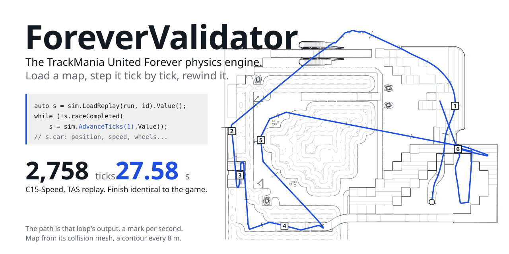
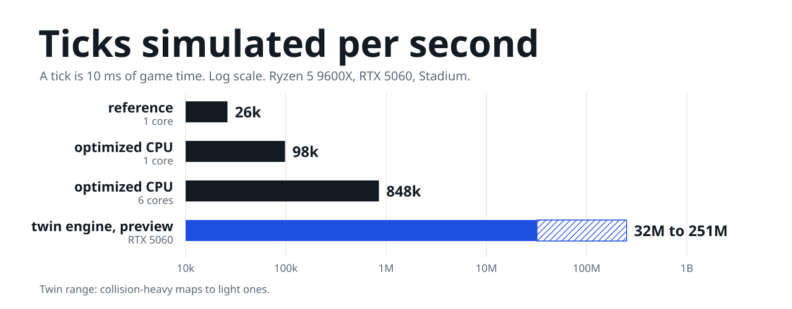

<picture>
  <source media="(prefers-color-scheme: dark)" srcset=".github/readme/hero-dark.svg">
  
</picture>

[](https://github.com/Skycrafter-dev/ForeverValidator/releases)
[](LICENSE)

ForeverValidator is the physics of TrackMania United Forever as a C++17
engine. Load any map from your own game install, drive it with inputs, step it
one 10 ms tick at a time and read the car's exact state, the same as the game
down to the last bit. All seven environments, every car, every game mode. Save
and rewind the whole simulation, change the inputs, or run thousands of copies
at once on the GPU.
Replay validation, the command-line tool, is built on top of it.

## Run the simulation

```cpp
#include <forevervalidator/experimental/physics_sandbox.h>
#include <forevervalidator/native.h>

#include <utility>

using namespace forevervalidator;
using namespace forevervalidator::experimental;

int main() {
    auto packs = OpenInstalledPackDirectory("/path/to/TmUnitedForever/Packs");
    auto sandbox = CreatePhysicsSandbox(std::move(packs).Value(), {});
    auto replay = ReadNativeReplayFile("run.Replay.Gbx", {"run.Replay.Gbx"});

    auto &sim = sandbox.Value();
    auto state = sim.LoadReplay(
            {replay.Value().data(), replay.Value().size()}, {"run.Replay.Gbx"});
    auto start = sim.CaptureState();                // save the whole simulation

    while (!state.Value().raceCompleted) {
        state = sim.AdvanceTicks(1);                // one tick = 10 ms
        const auto &car = state.Value().car;        // position, rotation, speed, wheels...
    }

    state = sim.RestoreState(start.Value());        // rewind to the start
}
```

That loop is what drew the path in the picture above. Error checks are left
out; every call returns a `Result` you can test.

What else a `PhysicsSandbox` does:

- `ReplaceInputs` swaps the whole input timeline; `ReplaceInputWindow` only a
  time range.
- `LoadScenario` starts from a bare `.Challenge.Gbx` map instead of a replay
  (with `PhysicsSandboxTimelineMode::Canonical` and a time horizon).
- `ReadScene` gives you the map's collision triangles and the car's collision
  shapes; `ReadRenderScene` its meshes and materials.
- `ClonePhysicsSandbox` and `AdvancePhysicsSandboxes` run many simulations side
  by side; `CreatePhysicsSandboxCudaSearchSession` runs whole batches of input
  variations on an NVIDIA GPU (Stadium) and returns the best.

The header is `<forevervalidator/experimental/physics_sandbox.h>`; the API can
still change. Snapshots don't copy the map's static collision data, so saving
and restoring is cheap.

## Speed

<picture>
  <source media="(prefers-color-scheme: dark)" srcset=".github/readme/speed-dark.svg">
  
</picture>

All exact backends give identical results; CPU numbers are the median over 10
Stadium campaign replays. The `cuda` search runs up to 173k candidate runs per
second on an RTX 5060.

A second engine, the twin, is in development (not released yet). It has the
same physics, written from scratch for search speed. It isn't
bit-exact, so every new best run it finds is re-checked by the exact engine.

## Validate a replay

1. Download `forevervalidator` for Linux or Windows from the
   [latest release](https://github.com/Skycrafter-dev/ForeverValidator/releases/latest).
2. Point it at the `Packs` folder of your TrackMania United Forever install
   and a replay:

```sh
forevervalidator --pak-dir "/path/to/TmUnitedForever/Packs" run.Replay.Gbx
```

The JSON report goes to standard output; exit status 0 means valid.

### Game files

You need the `Packs` directory of a complete **United** Forever install
(`packlist.dat` plus the Alpine, Speed, Rally, Island, Coast, Bay, Stadium,
Game and Resource packs). Nations Forever isn't enough: it only has Stadium.
No game files are included in this repository.

## Supported content

| Environment | Snow | Desert | Rally | Island | Coast | Bay | Stadium |
| --- | :---: | :---: | :---: | :---: | :---: | :---: | :---: |
| Car | SnowCar | DesertCar | RallyCar | IslandCar | CoastCar | BayCar | StadiumCar |

Any car on any environment (all 49 combinations), picked from the replay
itself. Race, Platform, Puzzle and Stunts modes, including shortcut and
multilap maps. Stunt scores are simulated, not copied from the replay.
TMUnlimiter, custom cars and custom physics are not supported.

Replays made with scripted inputs (TAS) are detected from their input clock.
They are still checked against their ghost, but reported as
`scripted_replay` and never as valid for competition.

GPU backends cover Stadium/StadiumCar in all four modes; everything else runs
on the CPU backends.

## Command line

Validate a whole folder in a batch and write one JSON file per replay:

```sh
forevervalidator --pak-dir "/path/to/Packs" --out-dir results/ replays/
```

| Option | What it does |
| --- | --- |
| `--out FILE` | write a single report to a file |
| `--out-dir DIR` | write one report per replay |
| `--backend NAME` | `reference` (default for one replay), `optimized-cpu`, `speculative-ticking`, `batched` (default for several), `cuda` |
| `--batch-size N` | replays loaded and submitted together (default 10) |
| `--requested-samples N` | compare only N evenly spread ghost samples; the whole run is still simulated |

Exit status: 0 valid, 1 invalid, another nonzero code when the replay can't
be decoded, the assets can't be loaded or the simulation can't run.

The JSON report has the environment, car, mode, replay provenance, whether
inputs match the ghost, expected and simulated results, trajectory counts,
maximum deviation and the first divergence. For scripted replays, the CLI also
prints the classification to stderr.

## Validation library

```cpp
#include <forevervalidator/native.h>
#include <forevervalidator/validation.h>

#include <utility>

using namespace forevervalidator;

void validateOneReplay() {
    auto source = OpenInstalledPackDirectory(
        "/path/to/TmUnitedForever/Packs");
    if (!source) {
        return; // Inspect source.Error().
    }

    auto context = CreateValidationContext(std::move(source).Value());
    auto replay = ReadNativeReplayFile(
        "run.Replay.Gbx", {"run.Replay.Gbx"});
    if (!context || !replay) {
        return;
    }

    auto report = ValidateReplay(
        context.Value(),
        {replay.Value().data(), replay.Value().size()},
        {"run.Replay.Gbx"});
}
```

Every call returns a typed `Result<T>`. A context caches pack and car data, so
reuse it across replays from any environment. Assets can also come from memory
(`AssetProvider`, `CreateAssetSource`). `ValidationOptions::backend` picks the
backend per call; `ValidateReplayBatch` runs an ordered list of replays and
keeps a report or error for each one.

```text
libforevervalidator_core.a    validation and simulation
libforevervalidator_json.a    JSON reports
libforevervalidator_native.a  files and pack directories
forevervalidator              command line
```

## Building

### Linux

Needs GNU Make, a C++17 compiler, and the zlib and OpenSSL libcrypto
development files:

```sh
make -j"$(nproc)"
```

Output: `build/native/forevervalidator` and the three libraries.

### GPU backends

The GPU backends build with CMake and run Stadium/StadiumCar:

```sh
cmake -S . -B build/gpu -G Ninja -DCMAKE_BUILD_TYPE=Release \
  -DFOREVERVALIDATOR_ENABLE_CUDA=ON
cmake --build build/gpu
```

| Backend | Switch | Needs |
| --- | --- | --- |
| Vulkan | `FOREVERVALIDATOR_ENABLE_VULKAN`, on by default | Vulkan headers and loader, Python 3 (the SPIR-V shaders are prebuilt) |
| CUDA | `FOREVERVALIDATOR_ENABLE_CUDA` | CUDA toolkit, GPU with compute capability 5.0 or newer (7.5 for the fast search kernel) |
| HIP (AMD) | `FOREVERVALIDATOR_ENABLE_HIP` | ROCm/HIP, CMake 3.30 or newer |

Never build with `-ffast-math` or FMA contraction: exact results depend on
exact float arithmetic.

### Windows

The [release](https://github.com/Skycrafter-dev/ForeverValidator/releases)
has a ready-to-run 64-bit `.exe`. To build it yourself, run this in PowerShell
from the repository:

```powershell
.\build-windows.bat
```

It downloads pinned, checksum-verified build tools and sources, then writes
`dist\forevervalidator.exe`. No admin rights, package manager or compiler
needed; downloads are cached for later builds.

Cross-building from Linux needs MinGW-w64, `curl`, `perl`, `tar` and
`sha256sum`:

```sh
JOBS="$(nproc)" make -j"$(nproc)" windows
```

This builds static OpenSSL 3.5.7 and zlib 1.3.2 from checksum-verified
sources and writes `build/windows/forevervalidator.exe`, with no MinGW DLLs
needed at run time.

### Docker

```sh
docker build -t forevervalidator .

docker run --rm \
  -v "/path/to/TmUnitedForever/Packs:/packs:ro" \
  -v "/path/to/replays:/replays:ro" \
  -v "/path/to/results:/results" \
  forevervalidator --pak-dir /packs --out-dir /results /replays
```

The container runs as a non-root user: make `/results` writable for it, or add
`--user "$(id -u):$(id -g)"`.

## Repository layout

```text
include/forevervalidator  public API
src/app/cli               command line
src/validation            validation and JSON reports
src/simulation            controls, simulation runtime, CPU and GPU backends
src/engine                game physics and scene runtime
src/format                replay, GBX, pack, tuning and solid decoding
src/platform/native       files and pack directories
tests                     tests
tools                     generators for the HIP sources and Vulkan shaders
```

## License

MIT, see [LICENSE](LICENSE). If you use this code, keep the copyright notice.

Development was accelerated with LLM assistance.
